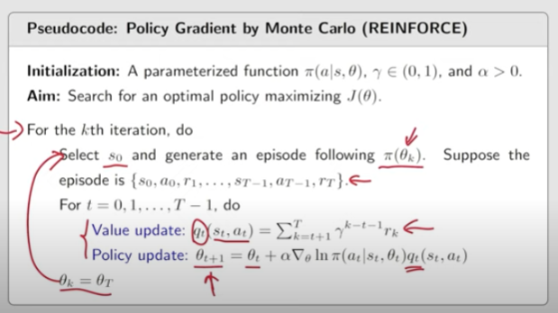

## RL 9: Policy Gradient methods
____
The main idea of policy gradient methods is smiliar to the value function approximation

We use a function $\pi(a|s,\theta)$ to describe policy instead of the tabular form.

And we try to use the gradient descent algorithm to maximize the object function J($\theta$), which is defined by policy function in metric form!

____
You might ask how we get the $\pi(a|s,\theta)$ when we input one state. Nowadays, we usually use the neural network.
And so optimizing the object function equals to adjusting the parameters and weights in the neural network?
I guess so.

___

$J(\theta)$ can be $\bar{v_\pi}$ $\bar{r_\pi}$ or $\bar{v_\pi^0}$

$$
\bar{r_\pi} \doteq \sum_{s \in S}d_\pi(s) r_\pi(s) = E(r_\pi(s)) \\
= E(\sum_{a \in A}\pi(a|s) r(s,a)) \\
=  E[\sum_{a \in A}\pi(a|s) \sum_r rp(r|s,a)]
= lim_{n \rightarrow \infty} \frac{1}{n} E[\sum^n_{k=1}R_{t+k}]
$$

$$
\bar{v_\pi} = \sum_s d(s) v_\pi(s) = E[\sum^{\infty}_{t=0}\gamma^tR_{t+1}]
$$

____

### REINFORCE (essentially a optimization problem)

### Policy Gradient by Monte Carlo (OFF-LINE FOR MC)

we define $J(\theta)$ and use the gradient-ascent algorithm
$$
\theta_{t+1} = \theta_t + \alpha \nabla_\theta J(\theta) \\
= \theta_t + \alpha E[\nabla_\theta ln\pi(A|S,\theta_t)q_\pi(S,A)]\\
=\theta_t + \alpha \nabla_\theta ln\pi(a_t|s_t,\theta_t)q_\pi(s_t,a_t)\quad stochastic
$$
Furthermore,
$$
\theta_{t+1} = \theta_t + \alpha \frac{q_t(s_t,a_t)}{\pi(a_t|s_t,\theta_t)} \nabla_\theta \pi(a_t|s_t,\theta_t) \\ 
= \theta_t + \alpha \beta_t \nabla_\theta \pi(a_t|s_t,\theta_t)
$$
If $\beta_t > 0$ ,the probability of choosing (st,at) is enhanced:
$$
\pi(a_t|s_t,\theta_{t+1}) > \pi(a_t|s_t,\theta_t)
$$

